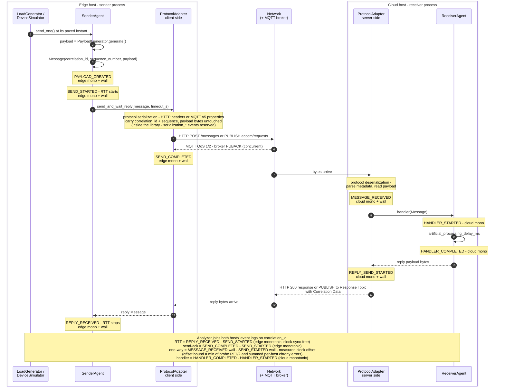
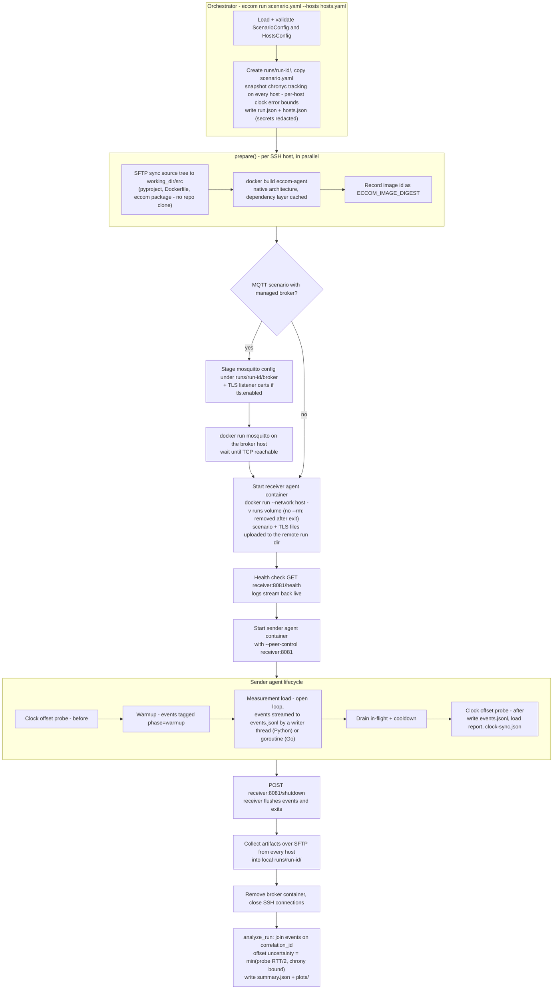
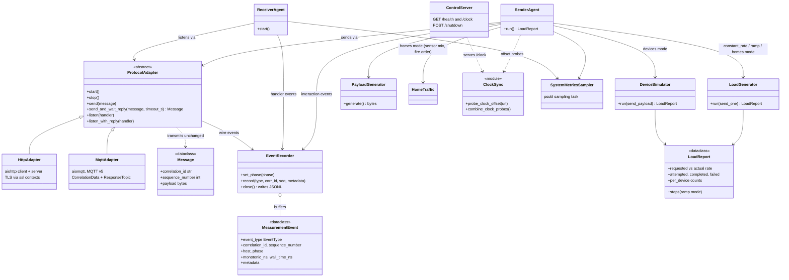
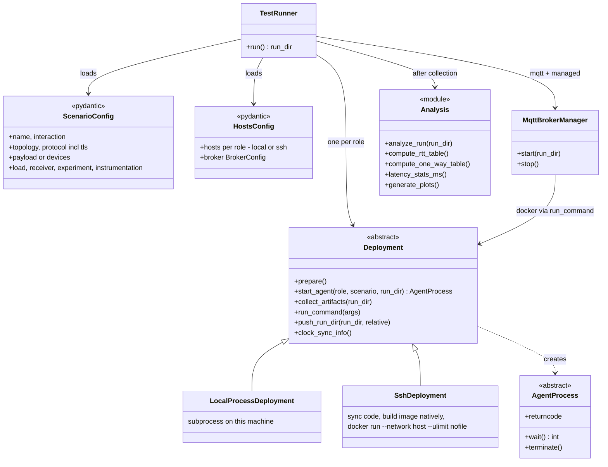

# eccom architecture diagrams

Four views of the framework: the life of one round-trip message with every
timestamp capture point, the deployment/run pipeline, and the class-level
structure split in two — the agent/protocol layer running inside the sender
and receiver processes, and the TestRunner orchestration layer that deploys
them and analyzes the results. GitHub and most IDEs render the mermaid blocks
natively.

## 1. One round-trip message (sequence + timestamps)

Every timestamp is captured by `EventRecorder.record()`, which stamps both
clocks at once: `monotonic_ns` (`perf_counter`, valid within one host) and
`wall_time_ns` (`time_ns`, cross-host with the measured offset). Protocol
(de)serialization happens inside the adapter/library and is not separately
timestamped.

## 2. Deployment and test run (process)

The SSH deployment needs only Docker and SSH on the targets: source is
synced (no repo clone), the agent image is built natively per host, agents
run as containers with host networking, and artifacts come back over SFTP.

## 3. Class structure — agents and protocol layer (high-level UML)

Everything below runs inside the sender/receiver agent processes. The only
link to the orchestration layer (diagram 4) is that the TestRunner starts
these processes via `Deployment.start_agent()` and later collects the event
logs they write.

The Go agent (`go/`, selected per role with `sender.implementation` /
`receiver.implementation: go`) mirrors this structure package by package —
`internal/agent`, `internal/load`, `internal/payload`, `internal/protocol`,
`internal/events`, `internal/control`, `internal/metrics`,
`internal/clocksync`; the mapping table is in `go/README.md` — and writes
the same events and artifacts. Two differences in shape: the Go
LoadGenerator paces one schedule from several goroutines inside one
process (`sender.threads`) where the Python sender runs one event loop per
process (`load.senders`), and the Go protocol adapters serve both roles from
one struct exactly as the Python classes do. DeviceSimulator has no Go
counterpart.

## 4. Class structure — TestRunner orchestration (high-level UML)

The orchestration layer runs on the operator's machine: it loads the configs,
deploys the agent processes from diagram 3 (via `Deployment.start_agent()`),
manages the broker, collects the artifacts, and runs the analysis.

